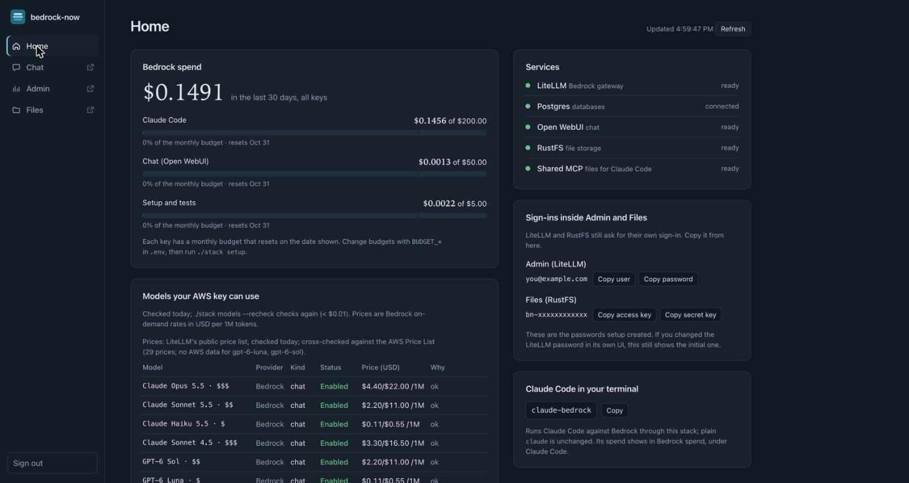

# bedrock-now

bedrock-now is a private, single-user AI workbench for your own Mac or Linux machine: a chat app, Claude Code
and a shared file store, with every model call billed to **AWS Bedrock** under your team's AWS access key. You
get modern models without sending your work to a consumer AI service, and you see what every answer costs.
Install it with one command; nothing listens beyond `127.0.0.1`.



## Quickstart

**Prerequisites**

- macOS or Linux, with **Docker Desktop** (macOS) or **Docker Engine 28+ with Compose v2** (Linux)
- `git`, `curl`, `openssl` (macOS's built-in bash 3.2 is fine)
- An **AWS access key ID and secret** for an IAM user with Bedrock access (long-lived `AKIA…` key; see
  [Asking your AWS admin for model access](#asking-your-aws-admin-for-model-access)), or, on an EC2 VM, an
  **IAM role** instead (no keys stored; see [Run it on a cloud VM](#run-it-on-a-cloud-vm))
- Optional: **Claude Code** (`claude`), for `claude-bedrock`

**Install** with the one-liner:

```bash
curl -fsSL https://raw.githubusercontent.com/JongoDB-Labs/bedrock-now/main/install.sh | bash
```

or inspect first:

```bash
git clone https://github.com/JongoDB-Labs/bedrock-now && cd bedrock-now
less install.sh setup.sh      # optional
./setup.sh
```

The installer checks the prerequisites and says how to install anything missing, clones the latest release
into `~/bedrock-now` (`BEDROCK_NOW_DIR=/path` for another folder, `BEDROCK_NOW_REF=main` for the newest code)
and starts setup. It never overwrites an existing folder: for an existing checkout it tells you to run
`./stack update`. Arguments go to setup (`… | bash -s -- --yes`).

**What happens.** Setup asks for your AWS key (the secret is hidden), region (default `us-east-1`) and an admin
email (default: your `git config user.email`). Exported `AWS_ACCESS_KEY_ID` / `AWS_SECRET_ACCESS_KEY` are offered
first; temporary credentials (`ASIA…`, `AWS_SESSION_TOKEN`) are refused because they expire. On an EC2 instance
with an IAM role and no key configured, setup offers the role instead and stores no key
([Run it on a cloud VM](#run-it-on-a-cloud-vm)). Then it:

1. verifies the key with AWS, picks free ports and the portal address, and generates every secret into `.env`
   (mode 600, never committed), including the portal password;
2. starts the stack and **probes every model** with a 1-token request (< $0.01 in total) to see which ones
   your key can use, and prints a table of ENABLED/DISABLED models with prices and reasons;
3. creates LiteLLM keys with monthly budgets, configures Open WebUI and runs a smoke test;
4. offers to link `claude-bedrock` into `~/.local/bin` (interactive runs only). It never edits your shell rc
   files or `~/.claude`.

At the end it prints the portal address and, the first time only, its password (always in `.env` as
`PORTAL_PASSWORD`), and, when run in a terminal, opens the portal in its own browser window.

**What it takes:** about 5 GB of Docker images (downloaded once, announced first), 5–15 minutes on the first
run depending on your connection (about 2 minutes after that), and under $0.05 of Bedrock usage to try it
(the probe and smoke test cost < $0.01; a short `claude-bedrock -p` prompt about $0.02–0.04).

**Stop or remove:** `./stack down` stops everything and keeps your data; `./stack up` starts it again.
`./stack uninstall` removes the containers, **all data volumes** and this install's built images (it keeps `.env`
and `backups/`); then delete the folder.

`./stack setup` is safe to re-run at any time: it keeps your keys and data and re-checks which models work.

## Using it

### The portal: one login for everything

Open http://bedrock-now.localhost (or the URL `./stack status` prints) and sign in with `PORTAL_PASSWORD`.
`*.localhost` names point at your own computer in every current browser, so there is nothing to configure. You
stay signed in for 30 days (Settings → Session length); **Sign out** at the bottom of the sidebar ends every session at once. `./stack
open` opens it: the installed app if you have installed it (see [Desktop app](#desktop-app)), otherwise a tab in
your browser.

| Tab | What it is | Sign-in |
|---|---|---|
| **Home** | Health of each service, spend per key against its budget, the models your key can use with prices, the price source, the `claude-bedrock` command. Refreshes every 30 s; makes no Bedrock calls. | the portal |
| **Chat** | Open WebUI at `chat.bedrock-now.localhost`: chat, documents/knowledge, images (if enabled) | automatic |
| **Admin** | LiteLLM's UI at `admin.bedrock-now.localhost/ui`: keys, spend by model and day, logs | automatic |
| **Files** | The RustFS console at `files.bedrock-now.localhost`: the shared object store | automatic |
| **Settings** | Every setting of `.env`, secrets masked; change passwords, the owner email, the AWS key, budgets, voice, OpenRouter and updates; backups and diagnostics ([Settings](#settings)) | the portal (each change asks for the password again) |

One sign-in is all there is: the portal signs you in to every app, in its tab, a pop-out window, on the remote
site and on a phone. Chat trusts the portal's word for who you are; for Admin and Files, which cannot, the portal
signs in to LiteLLM and RustFS for you with the sign-ins it already holds and hands the app's own session to your
browser on that app's address ([how](docs/security.md#automatic-sign-in-to-admin-and-files)). **Sign out** ends
the portal session that every request to Admin and Files needs, and every Admin (LiteLLM) session made before it
(also LiteLLM's own form's); the Files console's temporary credentials can stay valid in that browser for up to
12 hours, of no use without a portal session. LiteLLM's and RustFS's own sign-ins still exist, as a fallback and for
the API, under **Credentials** on Home:

| Fallback sign-in | User | Password |
|---|---|---|
| Admin (LiteLLM's form, `admin.…/ui/login/?sso=off`) | `OPENWEBUI_ADMIN_EMAIL` (`admin` before the first setup) | `LITELLM_UI_PASSWORD` |
| Files (the console's form, `files.…/rustfs/console/auth/login/?sso=off`) | `RUSTFS_ACCESS_KEY` | `RUSTFS_SECRET_KEY` |

Home's **Credentials** copies them and opens each app's own form; an app's own **Logout** shows that form too
(opening the app from Home again signs you in). A password changed inside LiteLLM's own UI is not known to the
portal: set it in Settings as well, or the automatic sign-in to Admin stops (it then says so, with a link to the form).

Each app stays open while you switch tabs; the arrow next to a tab opens it in its own browser tab. If port 80
is taken, the portal is on 8800 (`http://bedrock-now.localhost:8800`) and setup says so. To change the
password, use **Settings → Account & security** (or `./stack config set PORTAL_PASSWORD`). Setup prints the password once, and only
in a terminal; piped into a log it prints where it is instead. Tools can use the LiteLLM API at
`http://127.0.0.1:4000` (OpenAI- and Anthropic-compatible; keys in `.env`).

The installed version is always shown: under **bedrock-now** in the sidebar (on a tablet's icon rail as a tiny
label, the full version in the logo's tooltip; on a phone in Home's header). A build after a release reads
`v0.3.0 +7 (1a2b3c4)`: seven commits after v0.3.0, at commit 1a2b3c4; its tooltip adds the branch and the commit
date. Clicking it opens that version's release notes on GitHub (a build after a release: the changelog). While an
update is available it carries a small dot and leads to the update card's release notes instead; after an update,
reloading the page shows the new version.

### Walkthrough

New to the apps? **Walkthrough** at the bottom of the sidebar takes you through all of bedrock-now in about
20 minutes (a few cents of usage). It opens by itself on your first visit; on a desktop it widens the sidebar
instead of covering an app, on a tablet it is a card next to the icons, and on a phone it is under **More**.

1. **Set up:** the Bedrock models your AWS key can use (and how to get more), optional OpenRouter models, voice,
   Claude Code (and its lean `~/.claude-bedrock` config folder), each app's budget, and extras (the desktop app,
   one-click updates, use from your phone). Each step shows its live status from Home and the commands to run, with
   Copy buttons.
2. **Your apps (one sign-in):** the portal password is the only one you type; Chat, Admin (on Virtual Keys) and
   Files (on its buckets) open signed in, and opening each one ticks its step off. Admin's and Files' own sign-ins
   are folded away under **Credentials**, with Copy buttons and a link to each app's own form, for the API or in
   case the automatic sign-in ever fails.
3. **Use it together:** Home, a chat with its cost line, voice, your documents, Claude Code writing to the shared
   store and Chat answering from that file, and where the money went in Admin.

Steps tick off by themselves where the portal can tell (models enabled, OpenRouter or voice on, Chat, Admin or
Files opened, a key's spend going up); the others have **Mark as done** or **Skip**. Progress is kept in this browser only;
closing the walkthrough leaves the button with your progress, and **Start over** at the end resets it.

### Desktop app

Install the portal as an app and it gets its own window, its own icon in the Dock (macOS) or taskbar, a place
in Cmd-Tab / Alt-Tab, and it stays put when you minimize it. It is the same portal (same sign-in, Chat's
microphone keeps working), kept by your browser.

- **Install:** open the portal in Google Chrome or Microsoft Edge (`./stack open` does this) and click
  **Install app** at the bottom of the sidebar, or on Home. The button only shows when the browser can install
  it; otherwise use **⋮ → Cast, save and share → Install page as app** (Chrome) or **⋯ → Apps → Install this
  site as an app** (Edge). On macOS the app lands in `~/Applications/Chrome Apps.localized/` (Edge:
  `Edge Apps.localized`); keep it in the Dock with right-click → **Options → Keep in Dock**. On Linux it is
  added to your applications menu. Safari on macOS: **File → Add to Dock**.
- **Open it:** from the Dock, Launchpad, Spotlight or the applications menu, or with `./stack open`, which
  opens the installed app when it finds one and otherwise the portal as a tab in your everyday browser profile
  (with a one-time tip on how to install it). The app's **Chat** and **Home** shortcuts are on its Dock icon's
  right-click menu.
- **Once it is installed, a browser tab says so:** instead of **Install app**, the sidebar and Home show **Open
  in the app**, which brings the app forward (or starts it) on the tab you were on; the tab then says you can
  close it. The first time, the browser asks twice: **Open bedrock-now?** (tick *Always allow…*) and the app's
  **Allow app to open web+bedrocknow links?** (tick *Remember this choice*); after that it just opens. If
  nothing opens, Home lists the other ways in (and Chrome's **Open in app** button in the address bar does the
  same). Google Chrome and Microsoft Edge 140 or newer tell the page that the app is installed; other browsers
  learn it once the app has run, since the app and the browser's tabs share the site's storage. A tab left open
  catches up when you come back to it. Uninstall it and the tab offers **Install app** again. On Android, Home
  says where the app is (home screen, or **⋮ → Open in app**): there is no link that opens an installed web
  app there. Inside the app there is neither button. An app installed before this version learns its link when
  the browser next refreshes it from the portal's manifest (it does so when the app or a portal tab loads);
  until then **Open in the app** falls back to the list on Home. Answered **Don't allow** with *Remember this
  choice*? Chrome then never opens the app from the link: uninstall and reinstall the app (your data is in the
  stack, not in the app), or try removing bedrock-now under `chrome://settings/handlers` (Edge:
  `edge://settings/content/handlers`). If the same copy is installed in both Chrome and Edge, the operating
  system gives the link to one of the two apps.
- **Several copies:** each portal address is its own app: `bedrock-now` for the default one, `bedrock-now
  (bn-dev)` for a copy with `COMPOSE_PROJECT_NAME=bn-dev`, `bedrock-now (port 8800)` when the portal is not on
  port 80. If you rename the app in the install dialog, `./stack open` will not find it (it opens a tab). Each
  has its own **Open in the app** link (`web+bedrocknow` for the default copy, `web+bedrocknow` plus eight
  letters for any other copy or the remote address), so one copy's tab never opens another copy's app.
- **Uninstall:** in the app, **⋮ → Uninstall bedrock-now** (or chrome://apps → right-click → **Remove from
  Chrome**; Edge: edge://apps). Your data is in the stack, not in the app.
- `BEDROCK_NOW_OPEN_MODE=window ./stack open` brings back the old separate window (Chrome `--app` with its own
  browser profile); it has no Dock icon of its own.

### Using it on your phone

The portal is a web app you can put on your home screen. The stack only listens on this computer by default,
so a phone needs remote access (HTTPS) turned on first; a tablet or a small browser window works the same way.

- **Install it:** on an iPhone or iPad, open the portal in Safari, tap **Share → Add to Home Screen**. On
  Android, open it in Chrome and tap **⋮ → Install app** (Chrome offers this over HTTPS only; over plain
  http it can still add a shortcut). It opens full screen with the bedrock-now icon, like any other app.
- **Phone layout:** a tab bar at the bottom with **Home** and **Chat**; the phone opens on Chat and then
  remembers the tab you used last. Home is compact: total spend and each key's budget bar, one health line
  (tap it for every service), the update card when there is one, and the models as cards with an
  **Enabled only** filter (on by default on a phone). Chat fills the screen and shrinks above the keyboard, so
  the message box stays visible.
- **Admin and Files** are desktop apps: on a phone they sit under **More** in the tab bar and open in a new
  browser tab, already signed in. **Sign out** is there too.
  Update, Rollback and Clean are off from a phone unless `REMOTE_ADMIN_ACTIONS=true`; Home then says to use a
  desktop browser on the computer running bedrock-now.
- **Tablets** get the sidebar as a row of icons.
- **Dictation on iPhone and iPad:** use the 🎤 on the keyboard. It works in any text box, runs on the device,
  and does not need Open WebUI's microphone button (Chat shows this tip once; ✕ hides it for good).
- **Offline:** nothing from your account is stored on the phone. If the computer is asleep or out of reach,
  the app shows "Can't reach bedrock-now" with a **Try again** button.

### Chat (Open WebUI)

- **Models and tiers:** the picker shows friendly names with a price tier, e.g. `Claude Sonnet 5.5 · $$`
  (`$` under $0.50, `$$` under $3.00, `$$$` from $3.00 per 1M input tokens), the provider's logo, the exact price in
  the description and tags (`Bedrock`, vendor, tier). Embedding, rerank and image models are hidden from the
  picker but still work. Your own renames, icons and tags are kept.
- **Defaults:** `claude-sonnet-5-5` (else `claude-sonnet-4-5`, else `claude-haiku-5-5`) for anyone who hasn't
  picked their own; chat titles, tags and follow-ups are generated by the cheaper `claude-haiku-5-5`.
- **Cost under every answer:** a line in italics like `≈ $0.0069 · 1,240 in / 380 out · Claude Sonnet 5.5 ·
  chat ≈ $0.0412` shows this answer's cost and the whole chat's, from the same prices as `./stack costs`. It comes
  from the "Bedrock cost" filter (Admin Panel → Functions), which strips these lines before the chat goes back
  to the model, so they never cost tokens. After **Continue response** the line prices only the continued
  part; `./stack costs` is always exact. A free OpenRouter model's line starts with `free` instead of a price
  (`free · 1,240 in / 380 out · Gemma 4 31B (free) · ≈ $0.0002 at paid rates · chat ≈ $0.04`): nothing is
  charged, and the paid-rates figure (only when a paid version exists) is for comparison; the chat total stays
  what you actually pay.
- **Budget banner:** while the `open-webui` or `claude-code` key is at 80% or more of its monthly budget, a
  banner says so (red at 100%).
- **Knowledge:** Workspace → Knowledge to create a knowledge base and upload documents; type `#` in a chat to
  attach one.
- **Voice:** read-aloud uses your system's voices. The microphone and voice **calls** (the sound-wave button)
  use [server speech-to-text](#voice-speech-to-text): Mistral Voxtral on Bedrock, on by default when your AWS
  key can use it. Without server speech-to-text (`./stack stt remove`, or Voxtral not available) the microphone
  uses your **browser's** speech recognition — Chrome and Edge send dictated audio to Google or Microsoft
  (Safari can work on-device) — and Call is unavailable.

Settings changed in Open WebUI's admin panel revert at restart by design: `.env` and setup own the
configuration.

### Claude Code: `claude-bedrock`

`claude-bedrock` is Claude Code pointed at this stack. It sets the environment for its own process only, so
plain `claude` stays exactly as it was, and it takes the same arguments. It runs Claude Code with **its own config
folder, `~/.claude-bedrock`**, not your `~/.claude` ([why and how](#a-lean-config-folder-for-bedrock)).

- Models: main/opus = `claude-opus-5-5`, sonnet = `claude-sonnet-5-5`, haiku (background tasks, subagents) =
  `claude-haiku-5-5`. For a cheaper session: `CLAUDE_BEDROCK_MODEL=claude-haiku-5-5 claude-bedrock`.
- Each launch prints one line (hide it with `CLAUDE_BEDROCK_QUIET=1`):
  `bedrock · claude-opus-5-5 ($4.40 in / $22.00 out per 1M tokens) · spent $X.XX of $200.00 this period`,
  with `· ⚠ 84% of monthly budget used` from 80% on.
- When Claude Code exits, it prints what **this session** cost:
  `session: 14 requests · 420K tokens (38% cached) · $0.0384` (only on a terminal; `CLAUDE_BEDROCK_SUMMARY=1`
  forces it).
- Claude Code warns that "claude.ai connectors are disabled". That is expected: the wrapper's auth token takes
  precedence over your claude.ai login.

#### A lean config folder for Bedrock

Your everyday `~/.claude` may hold plugins, hooks, skills, agents and MCP servers. Bedrock takes no Anthropic beta
headers, and Claude Code's tool search (deferring MCP tools until they are needed) needs one, so on Bedrock the
definitions of all of them go into **every request**, billed per token. Measured on Haiku with a one-line
`claude-bedrock -p "Reply with just: ok"`:

| Claude Code's config | Requests | Input tokens per request | Cost |
|---|---|---|---|
| a well-stocked `~/.claude` | 5 | 258K–340K each | $0.094 |
| the same with `--strict-mcp-config` (MCP: only `bedrock-shared`) | 13 | 5K–63K each, plus two of 353K (hooks) | $0.112: no cheaper, hooks, skills and agents still load |
| an empty config folder (what `claude-bedrock` uses now) | 1 | 25K | $0.001 |

The lean folder was about 100× cheaper per prompt. With the full setup one real Opus request cost $1.44, and every
interactive launch made 4 requests ($0.13) before anything was typed: plugins' own Agent SDK calls. On a flat-rate
claude.ai plan that is invisible; billed per token it is not. So:

- **Lean by default.** `claude-bedrock` sets `CLAUDE_CONFIG_DIR=~/.claude-bedrock` (created on first use, mode 700):
  Claude Code's own tools, the stack's `bedrock-shared` MCP server, and the working folder's own `.mcp.json`,
  `.claude/settings.json` and `CLAUDE.md` (Claude Code reads those from the folder you start it in, whatever the
  config folder). The launch line says so: `config: lean (~/.claude-bedrock) — your ~/.claude plugins, hooks and MCP
  servers are not loaded; …`. The first launch asks Claude Code's first-run questions (theme, trusting the folder)
  once more. In lean mode a launch makes no model request until you type (Claude Code 2.1.301).
- **Your full setup anyway:** `CLAUDE_BEDROCK_USE_MY_CONFIG=1 claude-bedrock` uses `~/.claude` (or the
  `CLAUDE_CONFIG_DIR` you exported for plain `claude`), as before this change, with a ⚠ on the launch line: that
  can cost about 100× more per prompt (an empty `~/.claude` costs nothing extra).
  `CLAUDE_BEDROCK_CONFIG_DIR=/some/folder` picks another lean folder: an absolute path, not `/` or your home folder,
  and — like `~/.claude-bedrock` — owned by you and not writable by group or others (it holds settings that run
  commands), or the wrapper stops and says how to fix it. A `CLAUDE_CONFIG_DIR` you exported for plain `claude` is
  not used in lean mode: that is where the plugins live.
- **Bring things in one by one.** `~/.claude-bedrock` is an ordinary Claude Code config folder, and subcommands
  manage it: `claude-bedrock mcp add …`, `claude-bedrock plugin install …`. A personal
  `~/.claude-bedrock/CLAUDE.md` is read as usual; to reuse yours, `ln -s ~/.claude/CLAUDE.md ~/.claude-bedrock/`
  (or copy it for a Bedrock-only version) — the wrapper says this once, at a terminal, and never copies it, as it may
  hold things you don't want sent to Bedrock. Settings are separate now too: permissions, status line, output style
  (`settings.json`), `keybindings.json`, your own `commands/`, `agents/` and `skills/`. Copy what you want, e.g.
  `cp ~/.claude/keybindings.json ~/.claude-bedrock/`; from `settings.json` take only the keys you want
  (`permissions`, `statusLine`, `outputStyle`): a whole copy brings its `hooks` back, and an `env` block in it can
  override the wrapper.
- **Resume with `claude-bedrock --resume <id>`** (or `claude-bedrock --continue`): sessions are kept in
  `~/.claude-bedrock`, so the `claude --resume <id>` that Claude Code prints at exit does not find them. A new
  interactive session gets its id from the wrapper (`--session-id`), and when it ends the wrapper prints the right
  line, before the session cost: `resume: claude-bedrock --resume 0b2c3d4e-…`. That is the session you started; if
  you moved on with `/clear` (or `/new`, `/reset`) or an in-session `/resume`, the line adds `(after /clear or /resume:
  claude-bedrock --resume to pick)`. After `--continue` or the picker it names the session it can tell apart, or
  suggests the picker (`claude-bedrock --resume`) when several sessions wrote in that folder meanwhile. There is no
  such line for `-p`, with `CLAUDE_BEDROCK_QUIET=1`, or when stderr is not a terminal: use `claude-bedrock --resume`
  (the picker) or `claude-bedrock --continue` then.
- **Auto mode and model aliases on your computer.** Claude Code 2.1.283 and later counts its *auto* mode (a
  classifier model approving actions for you, on your key) as available behind this stack's API address, and may
  start in it; when the classifier cannot answer, it blocks the action. The browser terminal and the Code page turn
  it off; for `claude-bedrock` on your computer, add `"disableAutoMode": "disable"` to
  `~/.claude-bedrock/settings.json` to do the same. Name models in full (`CLAUDE_BEDROCK_MODEL=claude-haiku-5-5`, as
  above): with the alias `haiku`, Claude Code plans on Sonnet in *Plan* mode.

More details (session headers, signals, `--help`, the config folder): [docs/advanced.md](docs/advanced.md#claude-code-wrapper-details).

### Claude Code in the browser (optional)

```bash
./stack terminal enable                           # workspace: ~/bedrock-now-workspace (created, mode 700)
./stack terminal enable --workspace ~/projects    # or a folder of yours
./stack terminal status                           # ./stack terminal disable turns it off again
```

This adds a **Terminal** tab to the portal (on a phone: **More → Terminal**, full screen): `claude-bedrock` in a
tmux session, set up like the one on your computer (same models, the shared MCP server, the cost line and the
session cost on exit), but with **its own LiteLLM key**, `claude-code-terminal`, and its own monthly budget
(`BUDGET_TERMINAL`, $50, in Settings → Budgets & alerts; a Terminal meter on Home). `Ctrl-b c` opens a shell
window, `Ctrl-b n` switches. Its other settings are shown under Settings → Advanced, read-only: they change with
`./stack terminal`.
Reloading, closing the tab or losing the phone's connection only detaches: the session keeps running and opens
where you left it (until the container restarts: `./stack update`, `./stack terminal enable`, a reboot). Hold
Shift (Option on a Mac) to select text; an external keyboard helps a lot on a phone.

It is a sandbox, not a shell on your computer:

- Claude Code and the shell run in their own container, built on your machine from `terminal/` (Claude Code
  pinned by version and checksum, ttyd for the browser, git, node/npm, python/pip, ripgrep): as your user id,
  without root, capabilities or the Docker socket, on a read-only system. Of your files it sees **only the
  workspace folder** (at `/workspace`); `enable` — and every later `./stack up` — refuses your home folder
  itself, hidden folders like `~/.ssh`, `~/Library`, system folders, `/Volumes` itself and the bedrock-now folder
  (its `.env` holds every secret), in any spelling. Claude Code's settings and history live in the `terminal-home` volume.
- Inside the stack its only neighbour is its own gateway (a second, minimal Caddy), which passes just what Claude
  Code needs — LiteLLM's Anthropic API, model list and key info, and the shared MCP server's `/mcp` — and answers
  404 to everything else: LiteLLM's admin UI and API, the Bedrock pass-through, the portal and its login, Open
  WebUI, the databases. It never holds the master key or the `claude-code` key of `claude-bedrock` on your
  computer, and its own key works only for those LiteLLM paths, wherever it is used.
- Out, it reaches the internet (git clone, npm, pip, Claude Code's web fetch). On Docker Desktop that also means
  your computer's own services through Docker's host address — LiteLLM on `127.0.0.1:4000` (its key still only
  for Claude Code's paths) and the shared MCP server on `:8765` directly, the portal's login (without the password
  a runaway process can only keep the login's lock-out going for you), any dev server, and the Docker API if you
  exposed it on `tcp://localhost:2375`. The name `host.docker.internal` points nowhere in the container, but the
  address stays reachable: `TERMINAL_EGRESS=off` in `.env`, then `./stack up`, takes the internet and that path
  away.
- Opening it asks for the **portal password again**; that unlock lasts 12 hours in that browser, and Sign out
  ends it. Another website cannot drive it with your cookies: the terminal accepts connections only from its own
  page. Whatever answers there, its page runs only ttyd's own script and can set or clear no cookies.
- Over [remote access](#remote-access) it is **off** unless you set `REMOTE_TERMINAL=true` in `.env` (then
  `./stack up`; in Tailscale mode it is one more Service to approve, `./stack remote status` names it).
- What runs in it can spend its key (within `BUDGET_TERMINAL`), read and write the shared store and knowledge
  bases (so it could plant text that Chat's answers later draw on), and change anything in the workspace — which
  you may open on your computer later: a `.git/hooks` script or `core.fsmonitor`/`core.sshCommand` in
  `.git/config`, `.vscode/tasks.json`, `.envrc`, an npm script or Makefile, or Claude Code's own
  `.claude/settings.json` hooks and `.mcp.json` run on your computer when your tools (or `claude-bedrock` there)
  open the folder. Treat what the terminal wrote like code from someone else.

`./stack terminal disable` removes the container; the folder, Claude Code's history and the key stay (delete the
key in Admin to revoke it). The first `enable`, and `disable`, restart LiteLLM and the shared MCP server once (they
join or leave the terminal's gateway network): Chat answers, `claude-bedrock` requests and MCP sessions in progress
drop for a few seconds. Details and what was weighed: [docs/security.md](docs/security.md#the-browser-terminal).

### The Code page (optional)

```bash
./stack code enable                        # turns the browser terminal on too when it is off
./stack code enable --workspace ~/projects # its sandbox's folder, as for ./stack terminal enable
./stack code status                        # ./stack code disable turns it off again (the terminal stays)
```

Or from the portal: **Settings → Code page → On** (only on the computer running bedrock-now; **Off** works from
anywhere). The update helper runs `./stack code enable` / `disable` for you, and neither restarts the terminal (its
tmux session goes on). With the browser terminal off, **On** turns it on too, with the folder Settings names before
you confirm (the terminal's `TERMINAL_WORKSPACE`, or `~/bedrock-now-workspace`); another folder is chosen in a
terminal (`./stack code enable --workspace DIR`, or `./stack terminal enable --workspace DIR` later). If turning it on
fails, the previous settings come back and a terminal it had turned on is turned off again.

This adds a **Code** tab to the portal, directly under Chat (on a phone: **More → Code**, full screen): Claude Code
in an IDE-like page instead of a terminal — an explorer of the workspace on the left, an editor (CodeMirror) in the
middle, the chat on the right and the sandbox's terminal in a bottom panel (`Ctrl+\``); on a tablet the chat and
one of explorer/editor, on a phone the chat first with files, editor and diffs as sheets. Pane sizes are remembered
per browser.

- **Chat.** You type a prompt, the answer streams in (markdown, rendered as text-only DOM), thinking folds away, tool
  calls show as cards (Bash with its output, Edit/Write as a diff, Read, Grep, web fetches, subagents nested, MCP
  tools, to-do lists), background tasks get a Stop each, and **Stop** (or `Esc`) interrupts a turn. The `/` palette
  lists built-in commands, skills and plugin commands; `@` picks a file anywhere in the workspace (it searches it,
  skipping build and dependency folders such as `node_modules`, `dist`, `build`, `target` and `.venv`); images can be
  pasted or dropped (sent to Claude, scaled to 1568 px), other files are uploaded into the workspace and mentioned. A
  prompt typed while Claude works waits below the answer and runs next (or, when Claude Code takes it into the running
  turn between tool calls, as the terminal does, it shows there). `/clear` (`/new`, `/reset`) starts a new session
  with the same model, mode and effort; `/resume` opens the session list. Claude's latest to-do list stays pinned
  above the prompt; the conversation can be exported as Markdown (the whole transcript, not only what the page shows);
  notifications when a prompt waits or a turn ends are opt-in (⋯ menu).
- **Memory.** ⋯ → *Memory (CLAUDE.md)* edits this workspace's `CLAUDE.md` and your own in the sandbox
  (`~/.claude/CLAUDE.md`). A shortcut of the page's own: a one-line prompt starting with `# ` is added to the
  workspace's `CLAUDE.md` instead of being sent (the terminal's Claude Code has no such shortcut: ask Claude there,
  or use `/memory`).
- **Checkpoints.** Claude's file changes are tracked per prompt: *Restore files to here* on one of your prompts shows
  which files would go back (a dry run), then puts them back — also in a session whose process has ended (it starts
  again, without a prompt), never while Claude is working, and with a fresh dry run if Claude worked since. *Fork* on
  a prompt starts a new session with the conversation before it and puts the prompt back in the box to change, as the
  terminal's rewind does.
- **Permission prompts.** In the *Ask* mode a command or file change Claude wants to make asks first (reading the
  workspace and read-only commands such as `ls` or `git status` do not; in *Accept edits* file changes do not either),
  in a card that says what would run or change — **Allow once**, **Always** (the rule, shown before you click, saved
  in the sandbox's own Claude Code settings; never "skip all permissions"; where Claude Code proposes one for the
  workspace, a separate **Always, in this workspace's settings**, which Claude Code on your computer honours too) or
  **Deny** (with an optional note for Claude). In *Plan* mode Claude asks you to approve its plan: approve and let it
  edit (*Accept edits*), approve and keep asking (*Ask*), or keep planning with a note. A card shown only in part
  (very large input) can only be denied. A new card never takes the focus from the prompt box, the editor or the
  terminal panel, and its keys **1**/**2**/**3** answer only once you have clicked or tabbed into it. While a prompt
  waits the Code tab shows a badge (in a browser that has used the Code page, also before you open the tab); nobody
  answering for 30 minutes counts as Deny. When Claude asks *you* something (its AskUserQuestion tool), the card is a
  small form — one choice, several, or **Other** with your own words — and your answers go back to Claude as answers.
- **Model, mode, effort, cost.** You pick the model (this stack's models and prices), the permission mode (*Ask*,
  *Accept edits*, *Plan*, *Don't ask*; `Shift+Tab` cycles) and the effort; the meter shows each turn's and the
  session's cost and the context window's use.
- **Files.** The workspace's tree (new file/folder, rename, delete into `.bedrock-now-trash/`, upload by drag and
  drop, download); files open in the editor and save with a "changed on disk" check; Claude's edits open as a
  side-by-side diff, and an open file that Claude changed reloads (or says it changed under your unsaved edits).
- **Sessions.** Listed with search; resume, fork (also from any of your messages), rename — also from the Terminal
  tab's `claude --resume`, which
  shares them. A session keeps working when you close the tab or reload: the page re-attaches and shows what it
  missed, nothing twice. At most 4 sessions run at once (each Claude Code process takes ~220 MB of the sandbox's
  memory); an idle one stops after 30 minutes and your next prompt resumes it.
- **Plugins & marketplaces** (⋯ menu). What is installed (on/off, update, uninstall; the built-in ones read-only),
  the added marketplaces' catalog (search, install) and the marketplaces themselves (add `owner/repo`, an `https://`
  git URL or a folder of the workspace, `/workspace/…`, which works without internet; update; remove). Some plugins
  are installed by running a command their marketplace declares: the page then shows that command verbatim and its
  SHA-256, and only **Run this command and install** lets it run (Claude Code's `--accept-command <sha256>`; never
  `-y`). After a change the open sessions reload their plugins, so new commands and skills are in the `/` palette at
  once (that rewrites their prompt cache on the next turn).
- **MCP servers** (⋯ menu). Each server of the session with its status, tools and errors (the stack's
  `bedrock-shared` included); **Reconnect**, or switch one off and on for this session. Servers of your own (stdio,
  HTTP or SSE) are added to or removed from the sandbox's Claude Code user configuration — a stdio server's command
  runs **inside the sandbox only**, never on your computer; new servers load when a session starts (**Restart this
  session** does that for the open one).

It runs in the [browser terminal's](#claude-code-in-the-browser-optional) sandbox — the same container, workspace
folder, key (`claude-code-terminal`) and budget (`BUDGET_TERMINAL`), internet switch (`TERMINAL_EGRESS`) and
remote switch (`REMOTE_TERMINAL`) — so `enable` turns the terminal on when it is off, and `./stack terminal
disable` turns the Code page off with it. The page itself comes from a separate container that holds no LiteLLM
key and mounts no folder of yours: Claude Code runs in the sandbox (started there by a small spawn server on a
socket only the two containers share), the files you see are read and written there, and the costs it shows come
from LiteLLM's spend logs through the portal. Opening it asks for the portal password again (12 hours per
browser; Sign out or a new password locks it). That one unlock also opens its terminal panel: the page hands it to
the terminal's host with a one-time link (valid for a minute), which unlocks the terminal — the Terminal tab too —
until the Code page's unlock ends; the terminal's own unlock never opens the Code page.

**Costs.** Every prompt is billed like `claude-bedrock`, on the terminal's key; the page shows the session's cost
a few seconds after each turn (LiteLLM writes its logs in batches). Two things cost more than they
look: a **new session** and every **model switch within a session** make the next request write the prompt cache
for that model again — Claude Code's system prompt, tools and the conversation so far, ~26-30k tokens: about
$0.004 on Haiku 5.5, $0.08 on Sonnet 5.5, $0.16 on Opus 5.5 (the model list shows this per model). The cache
lives 5 minutes, so the first turn after a longer pause writes it again too. Haiku, Sonnet and Opus run exactly as
picked: the page names the model in full (with Claude Code's `haiku` alias, *Plan* mode would plan on Sonnet), and a
turn Claude Code ran on another model says so on its line; switching mid-session rewrites the prompt cache.

What the sandbox can do is what the terminal can (see above); on top, a compromised sandbox could show misleading
*text* in the Code page (fake tool output or diffs, a misleading permission sentence, a fake plugin catalog) but
cannot run script in your browser, reach the page's container, change the prices or costs shown, answer a permission
prompt itself, or accept a plugin's install command for you. Details:
[docs/security.md](docs/security.md#the-code-page).

**The page's code** lives in `code/web` (TypeScript, Preact, CodeMirror 6, marked's lexer; bundled by esbuild, every
dependency pinned in its lockfile) and is built into the image (`./stack code enable`, `./stack update`): nothing is
loaded from a CDN, and it runs under the main Caddy's CSP with Trusted Types. To work on it:

```bash
cd code/web && npm ci       # exact versions from package-lock.json
npm run dev                 # rebuilds on change + a mock backend on http://127.0.0.1:8095 (no stack, no Bedrock)
npm test                    # tsc --noEmit, then the unit tests
sh e2e/run.sh               # browser checks against the mock (desktop, tablet, phone, a hostile sandbox), in Docker
code/test.sh                # (from the repo root) the image's test stage: the frontend's and the backend's tests
```

### Claude Code from your phone

SSH into the machine from a phone SSH app (Blink or Termius on iOS, Termius or JuiceSSH on Android), start
`tmux new -A -s claude` and run `claude-bedrock` in it; a dropped connection then loses nothing. Tailscale on
both devices makes this work from anywhere without open ports. `./stack ssh-info` prints the exact commands
for this machine (its Tailscale name, the SSH command, apps, mosh). Without SSH, the optional
[browser terminal](#claude-code-in-the-browser-optional) runs Claude Code in a sandbox from the portal's More
menu. Claude Code's Remote Control doesn't work with Bedrock or a custom API URL. A sleeping Mac answers no SSH:
`./stack serve` keeps the stack up and the Mac awake (on AC power, lid open) until Ctrl-C (`--background`
without a terminal; on Linux only laptops get a sleep inhibitor). Step by step, incl. the lid-closed caveats: [docs/phone-claude-code.md](docs/phone-claude-code.md).

### Shared files and knowledge (MCP)

In `claude-bedrock`, `/mcp` shows the **`bedrock-shared`** server with the tools `list_files`, `read_file`,
`write_file(path, content, ingest_to=…)`, `list_knowledge_bases` and `search_knowledge`. Example prompt:
*"write `reports/summary.md` to the shared store and ingest it into knowledge base `Claude Code`"*. The file
then shows up in the **Files** tab (bucket `shared`) and in Chat as a knowledge base, and `search_knowledge`
searches the same index as Chat's `#`.

## Settings

The **Settings** tab (the gear in the sidebar; on a phone under **More**) shows every value of `.env`, grouped
like this: Account & security · AWS & models · Budgets & alerts · Voice · OpenRouter · Files · Updates & backups
· Remote access · Diagnostics · Advanced. Plain values are shown as they are; secrets only as *set* (with the
last four characters of generated keys and the `AKIA…` ends of the AWS key ID). The portal never reads `.env`:
`./stack` writes a masked copy, `.state/status/settings.json`, whenever `.env` changes (the page shows "as of").

**What you can change here**, each with what it restarts and for how long:

- the portal password (this browser stays signed in, every other device signs in again), the owner email (the
  same Chat account keeps its chats; the Admin sign-in follows), the Admin (LiteLLM) password, how many days a
  sign-in lasts (1-90), storing prompts; **Sign out other devices** and **Sign out everywhere**;
- the AWS access key (checked with AWS first, including Bedrock access, free; a key of another AWS account needs a
  tick; a failed smoke test puts the old key back), **Check AWS key** (free) and **Re-check models** (< $0.01, at
  most hourly);
- your own model choices: Chat's default model, its title/tag model and Claude Code's three slots (blank =
  automatic; Claude Code's slots take Claude models; setup keeps a pin while that model is enabled and warns
  when it is not), and which models Chat's picker
  leaves out (a tidier picker only: the API and Claude Code can still use them);
- the three budgets (at once, no restart; a warning when one is below this period's spend), the alert threshold
  (50-99%, default 80%) and the budget alert webhook;
- speech-to-text (Bedrock, OpenAI, Groq or the browser), OpenRouter's key and model set;
- the daily release and price checks, automatic updates and their hour, signed releases only (on only);
  **Back up now** (the newest 5 made here are kept), **nightly backups** (by the update helper, in a three-hour
  window you pick or, with automatic updates on, theirs, keeping the newest 1-60) and the list of backups (name,
  kind, size, date, and which one a rollback needs); a backup is refused when the disk could not hold it twice;
- **Regenerate** the Files (RustFS) key pair or the shared MCP token: new random values made by `./stack`, stored
  files stay;
- `REMOTE_ADMIN_ACTIONS` (off from anywhere, on only from this computer) and the allowed Tailscale login; the
  same rule for anything that would protect less (storing prompts, nightly backups off, fewer kept, longer
  sign-ins): only from this computer;
- **Diagnostics** (the password again): the smoke test (~$0.0001), a restart of one service, a status report to
  copy (your home folder shown as `~`; no secrets, emails, tailnet names or account numbers).

Reveal/Copy works only for values the portal already holds (the Admin and Files sign-ins, the three LiteLLM keys,
the shared MCP token), after the password again. Everything else in **Advanced** is read-only, with the reason and
the command that changes it (ports, host names, internal secrets). Restoring a backup stays a terminal command
(`./stack restore`): it replaces every chat, key and file with an older state.

**How a change is applied.** Changes need the [update helper](#updating) (`./stack helper install`): the portal
writes a small request, and the helper — outside Docker, as you — checks it again (the password against its own
copy, the allowlist, each value) and runs `./stack config apply`: the live checks first, one `.env` write, only
the restarts the change needs, free checks of the result, and on any failure the previous values back.
Without the helper the page is read-only and shows the terminal command next to each setting.

**In a terminal** the same rules apply:

```
./stack config                 # every setting, grouped like the page, secrets masked
./stack config get BUDGET_SETUP
./stack config set PORTAL_PASSWORD BUDGET_OPENWEBUI   # asks for each value (hidden for secrets)
./stack config check-aws       # free
./stack config regenerate rustfs
./stack restart litellm
```

Values never go on a command line (`config set` asks; scripts use `./stack config apply --stdin`). Each change is
logged by key name only (`.state/helper/settings-audit.log`) and Home says "Settings changed: … at …" for a day.
Keys that could send your data elsewhere (the AWS key, OpenRouter, speech-to-text providers, the alert webhook)
change only from this computer, never from a remote device. Details: [docs/security.md](docs/security.md#settings).

## Remote access

The portal from your phone or laptop, over HTTPS, without opening a port to the internet:

```bash
./stack remote enable tailscale      # https://bedrock-now.<tailnet>.ts.net (+ -chat, -admin, -files)
./stack remote status                # URLs, the Tailscale sidecar, whether your Tailscale login is checked
./stack remote test                  # checks from here, then a checklist for your phone
./stack remote disable               # back to this computer only
```

A small Tailscale container joins your tailnet and serves four
[Tailscale Services](https://tailscale.com/kb/1552/tailscale-services) with real certificates; your devices
need the Tailscale app. Remote requests need your **Tailscale login and the portal password**. The local address
keeps working unchanged. One-time steps in the Tailscale admin console (a tag, four Services, a policy snippet
and an auth key) are printed with your names filled in. Your own domain instead
(`./stack remote enable domain bedrock.example.com`, Let's Encrypt wildcard via Cloudflare DNS), how the
host-only session cookies work, and Cloudflare Tunnel: [docs/remote.md](docs/remote.md).

## Costs & budgets

You pay AWS Bedrock on-demand prices (USD, for the `us.` US-only inference profiles); nothing else in the
stack costs money. Full price table, worked examples and the update rules: [docs/prices.md](docs/prices.md).

**Prices update daily.** The portal fetches LiteLLM's public price list at start and every 24 hours and
cross-checks it with the public AWS Price List; `./stack setup` and `./stack up` check too. Guards keep a bad
upstream file from making prices vanish or jump; a refused change shows as a warning on Home and in `./stack
costs`. `./stack prices` checks now, `./stack prices --accept` applies a change the guards refused, and new
prices reach LiteLLM at the next `./stack up` (Home and the `claude-bedrock` line say `new prices pending` until
then). The fallback is `catalog/prices.tsv`; Settings → Updates & backups (`PRICE_UPDATES`) turns updates off.

**Budgets.** Setup creates three LiteLLM keys, each with a monthly budget: `claude-code` **$200**,
`open-webui` **$50** and `setup` **$5** (the model probe and `./stack test`). At its budget a key is refused
until the reset date shown by `./stack costs`. To change one, use **Settings → Budgets & alerts** or
`./stack config set BUDGET_OPENWEBUI` (likewise `BUDGET_CLAUDE_CODE`, `BUDGET_SETUP`): it applies at once, with no
restart, and keeps the reset date.

**Alerts.** Each key has a soft budget at **80%** (Settings → Budgets & alerts → Alert threshold, 50-99%): it never blocks, but `./stack costs`, Home and the
`claude-bedrock` launch line warn from there on. To also get a message, set **Settings → Budgets & alerts → Budget
alert webhook** (or `./stack config set ALERT_WEBHOOK_URL`) to any URL that accepts a JSON POST (an n8n, Zapier or
Make hook, for example). LiteLLM then
posts its own JSON alert (`soft_budget_crossed`, `budget_crossed`); it is not Slack's message format.

**Where to see spend:**
- `./stack costs`: prices for your enabled models, spend and budget per key, the 30-day total.
- **Home**: spend per key against its budget (amber from 80%, red at 100%) and the 30-day total. With
  OpenRouter on, an **Actual | Equivalent** switch (see [Optional: OpenRouter](#optional-openrouter)).
- **Admin** tab → Usage: spend by model and day.
- **Chat**: the cost under every answer and the chat total; each model's price in the picker.
- `claude-bedrock`: spend this period at launch, the session's cost at exit.

A single Claude Code prompt is several requests with a large cached context: a small task on Haiku costs
about $0.04, a long interactive Opus session can cost dollars. Use Haiku or Sonnet for routine work. Plugins and MCP
servers multiply this, which is why `claude-bedrock` leaves your `~/.claude` out
([a lean config folder](#a-lean-config-folder-for-bedrock)).

**Why Open WebUI adds tokens.** Open WebUI v0.12 lets the model call its built-in tools (search your knowledge
bases, chat history and notes, calendar, automations, skills, task lists, the time, …) and sends the
definitions of all of them, about 40 tools, with every chat request: a one-sentence question cost ~9,800 input
tokens instead of ~25. bedrock-now turns those always-on categories off for every model
(`DEFAULT_MODEL_METADATA` → `builtinTools` in `compose.yaml`), so a short question now costs about what it
costs through the API. The memory tools are off too (~2,000 tokens more, because the browser switches Memory
on in every chat): memories you save in Settings → Personalization → Memory still reach the model as context,
but the model can no longer add or edit them itself. Still on, and sent only while you switch the feature on
in a chat: image generation (when enabled), code interpreter and web search (off in this stack). Files you attach and knowledge bases you add
with `#` still work (Open WebUI retrieves the relevant passages and adds them to the prompt). One thing needs a
manual step: a custom model (Workspace → Models) with knowledge attached reads it through the Knowledge tool,
so tick **Builtin Tools → Knowledge** in that model's settings (its own Builtin Tools settings replace the
defaults: untick what it doesn't need). What remains is normal: later answers carry the earlier messages of
the chat, plus any system prompt you set; titles, tags and follow-up suggestions are separate small requests
on Haiku.

## Models & access

The probe decides what you get. Only an explicit "no" from AWS (not subscribed, access denied, wrong region)
disables a model; anything else keeps it and shows why. `./stack models` shows the last result (MODEL, KIND,
STATUS, PRICE, WHY); after your AWS admin changes your access, run `./stack models --recheck` (< $0.01) or
`./stack setup`.

| Model | Use |
|---|---|
| `claude-opus-5-5`, `claude-sonnet-5-5`, `claude-haiku-5-5`, `claude-sonnet-4-5` | chat, Claude Code |
| `gpt-6-sol`, `gpt-6-luna`, `grok-4-7`, `llama-3-3-70b`, `mistral-large-3` | chat |
| `titan-embed-v2`, `cohere-embed-v4` | document embeddings (Cohere preferred when enabled) |
| `cohere-rerank-3-5` | reranking for knowledge search (turns hybrid search on) |
| `sd3-5-large`, `stable-image-ultra`, `stable-image-core` | images in Chat (called in **us-west-2**) |

Cohere and the Stability image models need an AWS Marketplace subscription and are enabled automatically when
your key has access; they are **not yet verified end to end**, so please report problems.

### Asking your AWS admin for model access

If models show as **DISABLED**, send your AWS admin a request like this, listing the models `./stack models`
reports as *no Marketplace access*, *no model access* or *access denied*, with the Bedrock IDs from
`catalog/models.tsv`:

> Subject: Bedrock model access for bedrock-now
>
> Hi, I'm running bedrock-now (a local AI workbench that calls AWS Bedrock through LiteLLM) with the IAM user
> you gave me. Could you please:
>
> 1. **Enable model access / the AWS Marketplace subscription** in our account for these models, which the
>    setup probe reports as "no Marketplace access":
>    - `<model name>` (`<Bedrock model ID>`), `<region>`
>    - (Stability image models are only offered in **us-west-2**.)
> 2. **Make sure the IAM user has these actions** on the models above:
>    - `bedrock:InvokeModel`
>    - `bedrock:InvokeModelWithResponseStream` (needed for streaming chat and Claude Code)
>    - optional: `bedrock:ListFoundationModels`
> 3. **Rotate the long-lived access key on a short schedule**, and deliver new keys through a secrets manager or
>    password vault rather than in documents or chat.
>
> Thanks!

Then run `./stack models --recheck`.

### Model aliases

The catalog ships without aliases. If a tool still sends an old model name, put a comma list in the `aliases`
column of `catalog/models.tsv` and run `./stack setup`:

```
claude-opus-5-5	chat	bedrock/invoke/us.anthropic.claude-opus-5-5	claude-opus,claude-3-opus-20240229	-
```

LiteLLM then answers to those names with the real model (same price and key), and Chat keeps them out of its
picker. To add a model, see [docs/advanced.md](docs/advanced.md#adding-a-model).

## Optional: OpenRouter

[OpenRouter](https://openrouter.ai) offers hundreds of models from many providers, some free. bedrock-now can
add them next to your Bedrock models as `or/<id>`; it is **off unless you give it a key**.

```bash
# paste your key after OPENROUTER_API_KEY= in .env, then:
./stack openrouter apply               # checks the key with OpenRouter, then turns the models on
./stack openrouter set                 # or: asks for the key (hidden) and stores it in .env
./stack openrouter models free         # or: paid | all | a comma list of ids
./stack openrouter status | list | refresh
./stack openrouter remove              # back to Bedrock only
```

The portal's **Settings → OpenRouter** does the same as `set` from the computer running bedrock-now (not over
remote access): paste the key there, and it is checked before anything changes.

An account without credits can only use free models, so `apply`, `set` and setup then offer just those
(`OPENROUTER_MODELS=free`) unless you chose a set yourself. Once you have bought credits, the next `apply`,
`set` or setup offers paid models again (or run `./stack openrouter models all`).

**Set up your OpenRouter account** (once, on openrouter.ai):

1. **Create a key** at [Settings › API Keys](https://openrouter.ai/settings/keys). Name it `bedrock-now`; a
   credit limit is optional (it caps what this key can spend).
2. **Paste it** into `.env` after `OPENROUTER_API_KEY=` and run `./stack openrouter apply` (or run
   `./stack openrouter set`).
3. **Privacy** ([Settings › Privacy](https://openrouter.ai/settings/privacy)): most free models need *Allow
   free endpoints that train on request data*. That is a trade-off: those providers may keep your prompts and
   train on them. Without it, free models answer 404 (below). Leave *Allow free endpoints that publish
   prompts* off.
4. **Filter the model catalog for API keys** (recommended; Settings › Privacy › Model catalog): bedrock-now
   asks for the model list with your key, so with this on, Chat lists only the models your key can actually use
   under your provider restrictions and guardrails.
5. **Observability:** nothing to turn on. Leave *Input & Output Logging* (and *Broadcast*) off: Admin's logs
   already record every request (model, key, tokens, cost), and OpenRouter's logging would store your prompts
   at OpenRouter.
   OpenRouter's Activity page lists the requests under the app name `bedrock-now`.

**When an OpenRouter model fails** (the error shows in Chat):

| Error | Why | Fix |
|---|---|---|
| 404 *No endpoints found matching your data policy* | your privacy settings rule out every provider of that model (common for free models) | allow free endpoints that train on request data at [Settings › Privacy](https://openrouter.ai/settings/privacy), or pick another model |
| 429 *rate limited* | free models allow 20 requests a minute and 50 a day (1000 a day once you have bought at least $10 of credits) | wait, try another model, or buy credits |
| 429 *temporarily rate-limited upstream* / *Provider returned error* | a popular free model is busy at its provider, for everyone (not your limit) | retry shortly, pick another free model, or use the free router `or/openrouter/free` |
| 402 *payment required* | paid models need credits (a negative balance blocks free models too) | buy credits at [Settings › Credits](https://openrouter.ai/settings/credits), or `./stack openrouter models free` |
| 401 | the key was revoked or mistyped | a new key: paste it into `.env` and run `./stack openrouter apply` (or `./stack openrouter set`) |

In Chat they show their vendor's logo (Claude, GPT, Gemini, Llama, Qwen, DeepSeek, … or the OpenRouter logo
for vendors without one). Their prices go into LiteLLM, so spend, budgets, `./stack costs` and the cost line in Chat include them.

**Actual and Equivalent.** Free models really cost $0, so using them never eats into a budget. Home's Spend
card then has a switch (remembered per browser):
- **Actual**: what you are charged — Bedrock at its on-demand list prices (what bedrock-now records; your AWS
  bill can differ with discounts or credits), paid OpenRouter models at their prices, free models $0. Budgets
  always count actual spend.
- **Equivalent**: what the same usage would have cost if every request had been paid — each free model
  (`…:free`) priced at its paid version (the same id without `:free`); a free model without one stays $0 and is
  named as such. The budget bars keep showing actual spend.

The go-to free model is the free router `or/openrouter/free`: it picks a free model that is available right now.

Home also shows OpenRouter's own count of today's free-model requests against the key's daily limit (50 a day,
1,000 after buying $10 of credits; counted per UTC day), requests and tokens to `or/…` models today and in the
last 30 days (free / paid), the top models, and the last 24 hours' failed requests grouped by cause with the fix
(daily free limit reached, no credits, privacy settings that exclude free models, a rejected key, …).
`./stack costs` and `./stack openrouter status` print the same 30-day and today totals.

**Privacy:** a prompt to an `or/…` model goes to OpenRouter and the model's provider, and some free models may
log or train on your prompts; keep confidential work on Bedrock. Details: [docs/openrouter.md](docs/openrouter.md).

## Run it on a cloud VM

An always-on VM saves keeping a laptop awake. On **EC2**, give the instance an **IAM role** with Bedrock access
and setup offers to use it instead of an access key (only on an EC2 host; it proves the role can use Bedrock and
shows the account first; `AWS_AUTH=instance-role` in `.env`, no keys stored; AWS rotates the role's credentials). A `t4g.medium` (2 vCPU, 4 GB, arm64; every image runs on arm64)
with Amazon Linux 2023, a 30–40 GB gp3 disk and a security group with **no inbound rules** costs about
$31/month in `us-east-1` before Bedrock usage; you reach it over Tailscale. The recipe — least-privilege role
policy, IMDSv2 hop limit 2 (containers need it to reach the role), Docker on AL2023, data residency, costs and a
request template for your AWS admin — is in [docs/cloud-vm.md](docs/cloud-vm.md). Other providers (Hetzner,
DigitalOcean, …) work the same way with an access key.

## Voice: speech-to-text

Open WebUI's microphone and **Call** button need server speech-to-text (without it Call says *"Call feature is
not supported when using Web STT engine"*). bedrock-now uses **Mistral Voxtral on Bedrock** for it: no extra
key, and your recorded speech stays in your AWS account. Setup turns it on by default when its model check
finds Voxtral usable with your AWS key, and says so in one line (an interactive setup asks once: Bedrock,
OpenAI, Groq or browser only).

```bash
./stack stt status
./stack stt set bedrock                # Mistral Voxtral Small (default); `set bedrock mini` = cheaper, less reliable
./stack stt set openai                 # or: groq; outside Bedrock, asks for the key (checked first; stored in .env)
./stack stt remove                     # browser speech only (no Call); setup won't turn it back on
```

A small `stt` container (on an internal network, no internet access) converts the browser's recording (WebM/Opus or
MP4/AAC) with ffmpeg to MP3 and asks Voxtral for a verbatim transcript through LiteLLM with Open WebUI's own
key, so it counts on the `open-webui` budget and in Home's and `./stack costs`' spend (not in Chat's per-answer
cost line). Bedrock bills Voxtral per token; that works out to an **estimated ~$0.00014 per minute** of
continuous speech (~$0.008 per hour) for Voxtral Small; each short utterance in a call costs about $0.00005.
With it on, dictation also works in Firefox and in installed or home-screen web apps; answers in a call are
read aloud by your browser's voices.

The alternatives are an opt-in exception to Bedrock-only: OpenAI `gpt-4o-mini-transcribe` ($0.003 per minute)
or Groq `whisper-large-v3-turbo` ($0.0007 per minute; Groq bills at least 10 s per request, so its bill can be
2–5× what LiteLLM records). Your recorded speech then goes to OpenAI or Groq. Details, limits and
troubleshooting: [docs/voice.md](docs/voice.md).

## Bedrock by default: what leaves your machine

- **AWS:** model calls go to Bedrock (chat, embeddings, rerank, images, speech-to-text) through LiteLLM; setup
  also checks your key with AWS STS. There are no local models and no fallbacks; if no Bedrock model is enabled for a
  capability, it is off and setup says why.
- **OpenRouter, only if you add a key:** the `or/…` models go to OpenRouter. Without a key nothing contacts
  openrouter.ai.
- **Your voice:** with Bedrock speech-to-text (the default when Voxtral is usable), audio from the microphone
  and voice calls goes only to Bedrock in your AWS account, through the local `stt` container and LiteLLM.
  Read-aloud uses your system's voices. Without server speech-to-text, the microphone uses your browser's
  speech service (see [Chat](#chat-open-webui)).
- **Speech-to-text, only if you add a key:** with `./stack stt set openai|groq`, audio from the microphone and
  voice calls goes to OpenAI (`api.openai.com`) or Groq (`api.groq.com`) instead. Without a key nothing
  contacts them.
- **Price lists:** the daily price update downloads LiteLLM's public price list from GitHub
  (`raw.githubusercontent.com`) and the public AWS Price List (`pricing.us-east-1.amazonaws.com`). No
  credentials are sent; `PRICE_UPDATES=false` turns it off.
- **Update check:** once a day the portal asks GitHub's public releases API (`api.github.com`) for the latest
  bedrock-now release and, only when it is newer than yours, fetches that release's `compose.yaml` from
  `raw.githubusercontent.com` to estimate the download. Unauthenticated, https only; nothing about your
  install is sent (GitHub sees your IP address, as for any download). Settings → Updates & backups
  (`UPDATE_CHECK`) turns it off.
- **The browser terminal, only if you turn it on:** what you run in it may use the internet (git, npm, pip,
  Claude Code's web fetch) unless `TERMINAL_EGRESS=off`; Claude Code there still talks only to Bedrock, through
  its gateway and LiteLLM, with its non-essential traffic off. Building its image downloads Debian packages, Claude Code from npm
  and ttyd from GitHub.
- **Nothing else.** Open WebUI runs in offline mode with telemetry, web search and community sharing off;
  `claude-bedrock` turns off Claude Code's non-essential traffic; LiteLLM stores no prompt or response text.
  `./stack update` and image pulls contact GitHub and the image registries only when you run them.

## Commands

| Command | What it does | Bedrock cost |
|---|---|---|
| `./stack setup` | First-time or repeat setup: AWS key, ports, model probe, keys | < $0.01 |
| `./stack up` / `down` | Start / stop (data is kept) | none |
| `./stack status [--disk]` | Services, health, URLs and the disk this install uses (images, data, backups, and old images `./stack clean` would remove, if any; reused for 5 minutes, `--disk` measures now) | none |
| `./stack open` | The installed bedrock-now app, else the portal in a browser tab | none |
| `./stack logs [service]` | Follow logs (`litellm`, `open-webui`, `rustfs`, `postgres`, `shared-mcp`, `portal`, `caddy`, `stt`, `terminal`, `code`) | none |
| `./stack test` | End-to-end smoke test, incl. the portal login | ~$0.0001 |
| `./stack costs` | Prices for your enabled models + spend per key | none |
| `./stack prices [--accept]` | Check prices now; `--accept` applies a refused change | none |
| `./stack models [--recheck]` | Which models your key can use; `--recheck` re-probes | `--recheck`: < $0.01 |
| `./stack backup [--nightly]` | Databases + buckets + `.env` → `backups/<timestamp>/` (`--nightly`: the update helper's nightly backup, keeps `BACKUP_KEEP`) | none |
| `./stack restore DIR` | Replace all data with a backup, then test | ~$0.0001 |
| `./stack update [--to <tag\|branch>] [--force]` | Backup, new code, pinned images, setup; with nothing new it says so and stops (`--force` runs setup anyway) | < $0.01 (nothing new: none) |
| `./stack clean [--dry-run] [--yes]` | Remove this install's old images (lists them first; keeps one previous version); `--dry-run` only lists them | none |
| `./stack rollback [--yes]` | Back to the version before the last update: code, data (its backup), images | ~$0.0001 |
| `./stack helper install\|uninstall\|status` | One-click Update / Rollback / Clean on Home (a user-level background job; setup offers it) | none |
| `./stack helper auto on [--hour N]\|off\|status` | Automatic updates: a new release installs by itself at night, `N:00`–`N+3:00` this computer's time (default 3; off by default) | < $0.01 per update |
| `./stack remote status\|enable tailscale\|enable domain HOST\|disable\|test` | Optional: the portal from your phone/laptop over HTTPS through Tailscale ([docs/remote.md](docs/remote.md)) | none |
| `./stack rotate-aws [--use-keys \| --use-instance-role]` | Replace the AWS key (verified first), then test; the flags switch between an EC2 IAM role and a key | ~$0.0001 |
| `./stack serve [--background \| --stop]` | Start the stack and keep the Mac awake until Ctrl-C (prints the URLs) | none |
| `./stack ssh-info` | How to run `claude-bedrock` from your phone over SSH | none |
| `./stack openrouter …` | Optional OpenRouter: `status`, `set`, `apply` (the key pasted into `.env`), `remove`, `refresh`, `list`, `models` | none |
| `./stack stt …` | Speech-to-text for the microphone and voice calls: `status`, `set bedrock [small\|mini]`, `set openai\|groq [model]`, `remove` ([docs/voice.md](docs/voice.md)) | none |
| `./stack terminal status\|enable [--workspace DIR]\|disable` | Optional: Claude Code in the browser, a sandbox that sees one folder ([above](#claude-code-in-the-browser-optional)) | none (its sessions: per token) |
| `./stack code status\|enable [--workspace DIR]\|disable` | Optional: the Code tab, Claude Code with a chat, permission prompts and your files, in the terminal's sandbox ([above](#the-code-page-optional)) | none (its sessions: per token) |
| `./stack password [--show]` | Where the portal password is (`PORTAL_PASSWORD` in this folder's `.env`); `--show` prints it, only to a terminal | none |
| `./stack config [list\|get KEY\|set KEY…\|apply --stdin\|check-aws\|report\|regenerate rustfs\|mcp-token]` | Every setting, secrets masked; `set` asks for values (hidden for secrets) and applies them like the portal's [Settings](#settings) | none (`check-aws` is free; an AWS key change runs the test: ~$0.0001) |
| `./stack restart SERVICE` | Recreate one service with its current settings (`litellm`, `open-webui`, `shared-mcp`, `stt`, `rustfs`, `caddy`) | none |
| `./stack uninstall` | Remove the containers, ALL data volumes and this install's built images (keeps `.env` and `backups/`) | none |
| `./stack help` | All of the above; `./stack <command> --help` shows one | none |

`--yes` accepts defaults (non-interactive; AWS credentials can then come from `AWS_ACCESS_KEY_ID` /
`AWS_SECRET_ACCESS_KEY` / `AWS_REGION_NAME`). `NO_COLOR=1` turns colours off.

## Updating

```bash
./stack update                 # newest release
./stack update --to main       # or any tag / branch
```

When a newer release is out, Home shows an **update card** with its release notes, what the update will do
(backup, roughly how much it downloads, a few minutes of downtime) and the command to copy; `./stack status`
and the `claude-bedrock` launch line mention it too (they read the portal's last check; no network of their
own). Settings → Updates & backups (`UPDATE_CHECK=false`) turns the daily check off.

The update first asks git whether there is anything new. If not, and the last successful setup ran on exactly
this code, it says so (`already on v0.3.0 — nothing to update`) and stops: no backup, no restart, no Bedrock
calls. After a `git pull` or checkout by hand, an upgrade from an older version or a rollback, it runs every step
once. `./stack update --force` always runs every step. If
the last update moved the code but did not finish (its image pull or setup failed, or it was stopped), the next
`./stack update` finishes it, keeping that update's backup and rollback point.
Otherwise it runs four steps: **1/4** a backup (`backups/<ts>-auto/`; the newest 5 are kept, plus the one
`./stack rollback` needs), **2/4** the code (an install from a release tag moves to the newest release, never an
older one; a branch gets `git pull --ff-only`), **3/4** the pinned images, **4/4** setup and the smoke test, run
by the new code. It ends with a short "What's new": voice, remote access and one-click or automatic updates
(with the command that turns each on) and the release notes. Local changes to tracked files stop the update before
anything happens; they are never discarded. If a later step fails, or the new version misbehaves,
**`./stack rollback`** goes back: it checks out the code from before the update, restores the update's own
pre-update backup (taking a backup of the current state first) and starts the previous images, which are still on
disk. It also works when the update failed half-way. The failure message also shows the manual way
(`git … && ./stack restore <backup>`).

**One click from Home:** the update helper is a small background job under your user (a launchd agent on
macOS, a systemd user unit on Linux). Setup asks *Turn on one-click updates from Home? (Y/n)*, and so does the
next interactive `./stack update` of an install that has no helper yet; yes is the default. A "no" is
remembered and not asked again (an install that said no to the earlier opt-in question is asked once more).
`./stack setup --yes` installs it only with `BEDROCK_NOW_HELPER=1`, and `./stack helper install` works any
time. The portal cannot install software on your computer by design, so this one step happens in a terminal;
until then Home shows "One-click updates are off" with that command and a Copy button. With the helper, Home
shows **Update now**, **Roll back** and **Clean up old images**. Each asks for the portal password again, and
Home shows the progress (it reconnects when the portal restarts during the update) and the result, e.g.
"Updated to v0.3.0 · freed 3.1 GB". The portal itself still cannot run anything: it can only leave a request
that the helper checks strictly. The helper then runs one of those three `./stack` commands, one at a time (a
terminal `./stack update`, `rollback`, `clean`, `restore` or `setup` makes it answer "Busy"), with its own
limits (one a minute, 12 a day). It does not update a checkout that follows a branch unless
`BEDROCK_NOW_HELPER_ALLOW_BRANCH=1` is in `.env`. Details and the security checklist:
[docs/security.md](docs/security.md#the-update-helper). `./stack helper uninstall` removes it (and setup stops
offering it). An update that finds nothing new ends as "Already up to date"; neither it nor `--force` touches
the rollback target or the kept images.

**Automatic updates (off by default):** in Home → Maintenance, *Automatic updates: Off | Nightly (03:00–06:00)*
(asks for the portal password), or `./stack helper auto on [--hour N]` / `off` / `status` (`AUTO_UPDATE` and
`AUTO_UPDATE_HOUR` in `.env`). When on, the helper installs a new **release** by itself between `N:00` and
`N+3:00` on this computer's clock (default 03:00–06:00), the same way as Update now: a backup first, then a few
minutes of downtime, and Home's progress card ("Updated automatically to v0.4.0 at 03:04"). It installs only
the release Home announced (the portal's daily check, so not with `UPDATE_CHECK=false`) when it is also the newest
release tag after fetching origin, only on a checkout that is on a release (as `install.sh` leaves it; never a
branch, whatever `BEDROCK_NOW_HELPER_ALLOW_BRANCH` says), and only while the stack runs. Each release is tried
**once**: if it fails, Home shows the error with **Roll back** right there (when the update had already changed
the code), and that release is not tried again automatically (Update now tries again; a newer release is tried as
usual). A release you rolled back, also with `./stack rollback` in a terminal, is not installed again either, and
an update that did not finish (it failed after changing the code, or the computer stopped during it) holds
automatic updates back until Update now finishes it or Roll back goes back. If the window starts while something
else runs (a terminal `./stack` command, another action), with local changes, or when GitHub cannot be reached,
that night is skipped and Home says why. While an update runs, the helper keeps the computer from sleeping; **a
computer that is already asleep** when the window starts misses it and tries the next night; it does not update
when you wake it up and start working (keep a Mac awake with `./stack serve`, or pick an hour when it is on). A
`./stack update` in a terminal also restarts the helper with the new code.

`UPDATE_REQUIRE_SIGNED_TAGS=true` makes `./stack update` accept only signed release tags
([code provenance](docs/security.md#code-provenance)).

**Disk space:** an update keeps **one** previous version of every image it replaces (so going back needs no
download) and removes the version before that, then says what it freed, e.g. `freed 3.1 GB (old litellm
1.104.0, open-webui v0.11.2-slim)`. It only removes images this install used, never one that any container
(of any project) or another bedrock-now folder still needs, and never runs a global `docker … prune`. Its own
leftover builds (untagged images Compose labelled with this project) go too; a current `<project>/…:local` build
never does, even when its container is stopped. If Docker cannot list what is in use, nothing is removed.
`./stack clean` does the same on demand: it lists what it would remove and asks first (`--yes` skips the
question). `./stack status` shows how much disk the images, data volumes and backups take, and how much
`./stack clean` would free when there is something to free. Backups are unchanged: the newest 5 automatic ones are kept, and the one `./stack rollback`
restores is never pruned, however old.

**Updating from v0.1.x:** Open WebUI and the RustFS console no longer have their own ports (setup removes
`OPENWEBUI_PORT` and `RUSTFS_CONSOLE_PORT` from `.env`), so the old address such as `http://127.0.0.1:8080`
stops working. Open the portal URL the update prints, sign in with `PORTAL_PASSWORD` from `.env` and use the
**Chat** tab. Your chats, knowledge bases, files and spend history are unchanged.

## Troubleshooting

| Symptom | Fix |
|---|---|
| A model shows **DISABLED** (no Marketplace access, no model access, access denied), or "no models are usable with this AWS key" | Your AWS account or IAM user can't use it, or the region is wrong. Ask your AWS admin (see [above](#asking-your-aws-admin-for-model-access)), then run `./stack models --recheck`. |
| A URL from this README doesn't work | Setup moved a port because something else used it (port 80 taken, or rootless Docker → the portal is on 8800). See `./stack status` or `PORTAL_PORT` / `*_PORT` in `.env`. |
| `http://bedrock-now.localhost` doesn't resolve | Use a current Chrome, Edge, Firefox or Safari; they resolve `*.localhost` themselves. Command-line tools may not: `curl --resolve bedrock-now.localhost:80:127.0.0.1 http://bedrock-now.localhost/login`. |
| The portal shows its login page after you followed a link to it from another site | Expected with `SameSite=Strict`: such a visit arrives without the session cookie. Type or bookmark the URL. |
| Forgot the portal password | It is `PORTAL_PASSWORD` in `.env`: `./stack password` says which file (the login page names it too, with the Compose project, so a second copy is not mixed up), `./stack password --show` prints it. After five wrong tries the login waits a few seconds (up to five minutes). |
| The old Open WebUI address (`127.0.0.1:8080`/`8082`) stopped working after an update | By design: browsers reach every app through the portal now. Open the URL from `./stack status`. |
| A setting changed in Open WebUI's admin UI reverts after a restart | By design (`ENABLE_PERSISTENT_CONFIG=false`): `.env` and setup own the configuration. |
| `claude-bedrock` ignores the stack, or uses the wrong model or key | An `env` block in Claude Code's user settings (`~/.claude-bedrock/settings.json`; `~/.claude/settings.json` with `CLAUDE_BEDROCK_USE_MY_CONFIG=1`) or the folder's `.claude/settings.json` (e.g. `ANTHROPIC_BASE_URL`, `ANTHROPIC_MODEL`) overrides the wrapper. Remove those keys. |
| Your plugins, MCP servers, `CLAUDE.md` or keybindings are missing in `claude-bedrock` | By design: it uses its own config folder, `~/.claude-bedrock`. Add what you need there (`claude-bedrock mcp add …`, `claude-bedrock plugin install …`, a `CLAUDE.md`), or run with `CLAUDE_BEDROCK_USE_MY_CONFIG=1` ([a lean config folder](#a-lean-config-folder-for-bedrock)). |
| `claude --resume <id>` finds no conversation after `claude-bedrock` | Its sessions are kept in `~/.claude-bedrock`: `claude-bedrock --resume <id>`. |
| `claude-bedrock --debug mcp list` fails | Options placed *before* a subcommand trip the wrapper's MCP flag. Use `claude-bedrock mcp list --debug`, or plain `claude` for management commands. |
| "LiteLLM is not running" from `claude-bedrock` | `./stack up` |
| Requests fail for about a minute during `./stack setup` | LiteLLM restarts while setup probes the models. Wait, or avoid running setup mid-session. |
| "project '…' is already used by the bedrock-now install in …" | Another folder owns this project name. If this folder replaces it (moved or copied with its `.env`), run `./stack down` there, move that folder aside or delete it (it holds its own `backups/` and `.env`), and re-run here. Otherwise use that install, or remove it with `./stack uninstall` there. A checkout that was never set up can take another name: `COMPOSE_PROJECT_NAME=<other name> ./setup.sh`. See [docs/advanced.md](docs/advanced.md#running-a-second-copy). |
| "… containers started from …, a folder that no longer exists" | Remove them with `docker compose -p <project> down` (the data volumes are kept), then re-run. |
| "project '…' was just claimed by …" | Another checkout ran a command at the same moment and now owns the project; fix it as for "already used". If it says "a record pointing to …, which no longer exists", just re-run. |
| "project '…' is already used by another Compose project in …" | Something other than bedrock-now uses this project name. Stop it there (`docker compose down`), or set up this copy with `COMPOSE_PROJECT_NAME=<other name> ./setup.sh`. |
| "./stack uninstall here would delete project '…'" | The volumes belong to another folder's install; run `./stack uninstall` there instead. |
| Setup can't sign in to the portal or to Open WebUI through it | Run `./stack logs portal` and `./stack logs caddy`. If you edited `PORTAL_PASSWORD` in `.env` by hand, run `./stack up` (it hashes the new one for the portal). |
| Settings: "changed on disk since you opened the page" | `.env` changed in the meantime (a terminal command, or an edit by hand): reload the page and make the change again. |
| Settings shows everything but nothing can be changed | Changes need the update helper: `./stack helper install` (or use `./stack config set KEY` in a terminal). From a remote device they also need `REMOTE_ADMIN_ACTIONS=true`. |
| Speech-to-text error in Chat | Your browser has no speech recognition (e.g. Firefox), or you use an installed / home-screen app. [Server speech-to-text](#voice-speech-to-text) works there: `./stack stt set bedrock`. |
| "Call feature is not supported when using Web STT engine" | Voice calls need [server speech-to-text](#voice-speech-to-text): `./stack stt set bedrock` (no key; `./stack stt status` says why it is off), or `openai` / `groq`. |
| "Error transcribing chunk: External: …" | The message after it says what failed (budget, model access, throttling, a too-long recording); see [docs/voice.md](docs/voice.md#troubleshooting). |
| Admin says "automatic sign-in did not work" | It names the reason (LiteLLM not running, or it refused the password the portal has). If you changed the Admin password inside LiteLLM, set it in **Settings → Account & security** too; meanwhile **Sign in with the password instead** opens LiteLLM's own form. Files likewise (RustFS not running, or a key pair edited by hand: `./stack config regenerate rustfs`). |
| LiteLLM's own form refuses `admin` | Once setup has created the database admin, sign in with `OPENWEBUI_ADMIN_EMAIL` / `LITELLM_UI_PASSWORD` (Home → Credentials shows both); the shared `admin` login is off. |
| Forgot the LiteLLM admin password (you changed it in the LiteLLM UI) | Set a new one in **Settings → Account & security** (or `./stack config set LITELLM_UI_PASSWORD`): it is changed in LiteLLM itself, with the master key when the old one no longer works. Editing `LITELLM_UI_PASSWORD` in `.env` alone does nothing once the admin exists (`./stack up` then warns and repairs it). |
| Home warns about prices (refused change, stale, LiteLLM/AWS gap) | See [docs/prices.md](docs/prices.md#guards). After checking a refused change: `./stack prices --accept`, then `./stack up`. |
| A service doesn't come up during setup | Setup prints its last log lines; run `./stack logs <service>`, or re-run with `BEDROCK_NOW_VERBOSE=1 ./stack setup`. |
| Anything else | `./stack status` and `./stack test`, then `./stack logs litellm` / `./stack logs open-webui`. |

## Advanced

- **A second copy** (to try a branch next to your main stack): clone into another folder and run
  `COMPOSE_PROJECT_NAME=bn-test ./setup.sh`. It gets its own containers, data, ports and portal name
  (`http://bn-test.localhost`). See [docs/advanced.md](docs/advanced.md#running-a-second-copy).
- **Linux, SELinux, rootless Docker:** supported (Docker Engine 28+; your user in the `docker` group; rootless
  puts the portal on 8800). See [docs/advanced.md](docs/advanced.md#linux-selinux-and-rootless-docker).
- **A non-`.localhost` portal name** is refused unless you set `BEDROCK_NOW_ALLOW_PUBLIC_HOST=1`: the portal is
  plain HTTP. See [docs/advanced.md](docs/advanced.md#portal-host-name-port-and-the-public-host-opt-in).
- **Verbose output:** `BEDROCK_NOW_VERBOSE=1 ./stack setup` shows the full docker compose output (also for
  `restore` and `rollback`, which otherwise leave out Compose's per-container "Waiting / Healthy" lines).
- **Backups, restore on a new machine, AWS key rotation, adding models, the portal window:**
  [docs/advanced.md](docs/advanced.md).

## Testing

- **Unit tests** (no Docker, no AWS): `/bin/bash tests/run.sh` (bash 3.2), plus the Python tests in
  `portal/tests`, `shared-mcp/tests` and `owui/tests`.
- **End-to-end suite** (opt-in, run by hand; not part of `tests/run.sh` or CI): `tests/e2e/run.sh --aws-env FILE`
  builds a throwaway copy of this checkout under its own project (`bne2e.localhost`, free ports — never your
  install's), runs setup non-interactively, drives every page in a pinned Playwright Chromium container (login,
  Home, Chat with a streamed answer and a file question, voice calls and speech-to-text, Admin, the RustFS
  console's upload/download/delete, phone and tablet layouts, sign-out), checks every portal route, header and CSRF rule, runs the safe `./stack`
  commands (backup/restore, down/up, update, rollback) and `claude-bedrock -p`, then removes everything it
  created. About 10-15 minutes and about half a cent of Bedrock (capped by small budgets; the total is printed);
  results as a table and JUnit XML in `tests/e2e/out/`. `--terminal` (or `E2E_TERMINAL=1`) also turns on the
  browser terminal and checks it (lock, unlock, tmux, Origin, isolation; with the claude part one
  `claude-bedrock -p` inside it, ~$0.02). `--code` (or `E2E_CODE=1`) also turns on the Code page and checks it
  (unlock, CSP, a Haiku session: streaming, permission allow/deny and the badge, model switch, interrupt, a slash
  command, re-attach and resume, files, spend; then the page itself as a person uses it — a Bash prompt allowed in
  its card, an @-mentioned file edited and its diff, the palette, an upload, a reload without duplicates, an
  AskUserQuestion answered, plugins from a marketplace in the workspace with the install command confirmed by its
  SHA-256, the MCP panel, a phone, the Settings row — each with zero CSP violations; isolation; a hostile stand-in
  on its spawn socket; ~$0.03). Its unit tests (frontend and backend) run in its image's test stage:
  `code/test.sh`; the page's browser checks against a mock: `sh code/web/e2e/run.sh`. `--helper` (or `E2E_HELPER=1`) also runs the throwaway's update helper
  in the foreground (never installed as a service) for the Settings checks. What is covered, and what stays manual:
  [tests/e2e/INVENTORY.md](tests/e2e/INVENTORY.md). Options: `tests/e2e/run.sh --help` and
  [docs/advanced.md](docs/advanced.md#end-to-end-tests).

## Security model

- One way in for browsers: Caddy on `127.0.0.1`, which asks the portal to check a signed, `HttpOnly`,
  `SameSite=Strict` session cookie before every request. Open WebUI trusts a sign-in header that only Caddy
  can set; LiteLLM and RustFS get their own sessions from the portal, handed over on their own host names and
  never in a URL; the apps may be framed only by the portal.
- Every host port binds to `127.0.0.1`. AWS credentials reach only the LiteLLM container and never appear on a
  command line; all secrets live in `.env` (mode 600). On EC2 with an IAM role there are no AWS keys at all, but
  every container on the VM can fetch the role's temporary credentials from the metadata service unless you
  firewall it ([docs/cloud-vm.md](docs/cloud-vm.md#keeping-the-roles-credentials-to-litellm)).
- Images are pinned by version (Caddy also by digest) and Python dependencies are hash-locked.
- The update helper runs only `./stack update|rollback|clean` (and `./stack helper auto on|off`) for this
  checkout, on a strictly checked request that the portal writes after you re-enter the password, within its
  own rate limits; with automatic updates on, also `./stack update` for a new release tag at night. Its
  buttons are off for remote access by default. Only `./stack remote`'s Caddy blocks mark requests as remote;
  an SSH tunnel or your own reverse proxy to `127.0.0.1` counts as local.
- Settings changes are requests too: the helper checks the password against its own hash (the portal holds
  only a hash of it, never the password), its own allowlist and each value, and runs `./stack config apply`
  with the values on stdin; keys that could send data elsewhere, and settings that would protect less, change
  only from this computer.
- The browser terminal is off by default. When on, it is a container (not a shell on your computer) that sees
  one folder of yours, has its own LiteLLM key and budget, and reaches inside the stack only a gateway that passes
  Claude Code's few LiteLLM paths and the shared MCP server; opening it needs the portal password again, it refuses
  other sites' connections, and remote access leaves it out unless `REMOTE_TERMINAL=true`. What it writes into
  the workspace can run on your computer when you open that folder there.
- The Code page is off by default too, and runs Claude Code in that same sandbox. Its page comes from a container
  with no LiteLLM key, no folder of yours and no network but the one it shares with Caddy; it needs its own
  password unlock, treats everything from the sandbox as untrusted text (a strict CSP with Trusted Types, set by
  Caddy whoever answers), and takes models, prices and costs from the portal, never from the sandbox.
- Remote access is off by default. When on, nothing is published on the host either: a Tailscale container
  connects outbound, terminates HTTPS and reaches Caddy's internal remote listener; the remote site uses
  host-only `Secure` cookies (one per host name, handed over by single-use tokens) and requires your Tailscale
  login ([docs/remote.md](docs/remote.md)).

Details: [docs/security.md](docs/security.md).

## Repo layout

```
stack, setup.sh, install.sh   the CLI, setup and the one-line installer
bin/claude-bedrock            Claude Code wrapper
bin/bedrock-now-helper        the update helper: one-click and automatic updates (./stack helper)
compose.yaml                  all services (images pinned)
compose.tailscale.yaml        remote access: the Tailscale sidecar (only while ./stack remote is on)
compose.domain.yaml           remote access under your own domain: Caddy with a DNS plugin
compose.terminal*.yaml        the optional browser terminal and its gateway (only while ./stack terminal is on)
compose.code.yaml             the optional Code page (only while ./stack code is on, with the terminal)
caddy/Caddyfile               the reverse proxy (no secrets); caddy/remote-*.caddy the remote site,
                              caddy/terminal-*.caddy the terminal's site and its gateway, caddy/code-*.caddy
                              the Code page's site
tailscale/                    the sidecar's serve config (written by ./stack remote)
portal/                       login + Home service (Python; tests: docker build --target test portal)
terminal/                     the browser terminal's image: Claude Code (pinned), ttyd, tmux, the Code page's
                              spawn server (bin/bn-coded.mjs)
code/                         the Code page: its backend (server/, Agent SDK pinned with Claude Code), the page
                              (web/: Preact + CodeMirror 6, built into the image; a mock backend in web/dev) and
                              a plain fallback page (plain/); tests: code/test.sh, code/web/e2e/run.sh
shared-mcp/                   MCP server for shared files and knowledge (Python; tests: docker build --target test shared-mcp)
owui/functions/               the Open WebUI cost filter (tests in owui/tests)
catalog/                      models, prices, display names, icons, AWS price map
lib/*.sh                      the shell code (bash 3.2-compatible)
tests/run.sh                  shell tests
tests/e2e/                    opt-in end-to-end suite (throwaway stack + Playwright; INVENTORY.md)
docs/                         longer reference pages
```

## License

MIT. See [LICENSE](LICENSE).

**Logos:** the model logos in `catalog/icons/` come from [lobe-icons](https://github.com/lobehub/lobe-icons)
(MIT, © LobeHub; see [catalog/icons/LICENSE-lobe-icons](catalog/icons/LICENSE-lobe-icons)). They are
trademarks of their respective owners and are used only to identify each provider's models; no endorsement is
implied.
